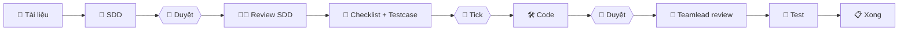

# 📘 Hướng dẫn sử dụng ai-team

Tài liệu này hướng dẫn từ lúc cài plugin đến khi chạy xong một task thật. Đọc theo thứ tự lần đầu; các lần sau chỉ cần xem [Bảng lệnh](#9-bảng-lệnh) và [Xử lý sự cố](#10-xử-lý-sự-cố).

**Mục lục**
1. [Tổng quan](#1-tổng-quan)
2. [Yêu cầu](#2-yêu-cầu)
3. [Cài plugin](#3-cài-plugin)
4. [Cập nhật và gỡ plugin](#4-cập-nhật-và-gỡ-plugin)
5. [Chuẩn bị project](#5-chuẩn-bị-project)
6. [Chạy một task từ đầu đến cuối](#6-chạy-một-task-từ-đầu-đến-cuối)
7. [Task nhỏ (size S)](#7-task-nhỏ-size-s)
8. [Dừng giữa chừng và chạy tiếp](#8-dừng-giữa-chừng-và-chạy-tiếp)
9. [Bảng lệnh](#9-bảng-lệnh)
10. [Xử lý sự cố](#10-xử-lý-sự-cố)
11. [Mẹo tiết kiệm quota](#11-mẹo-tiết-kiệm-quota)

---

## 1. Tổng quan

Ba agent làm việc như một team, **anh là người quyết định mọi thứ**:

| Agent | Vai trò |
|---|---|
| 🧭 `teamlead` | Đọc tài liệu → phân tích → viết SDD + diagram → review source sau khi dev xong |
| 🧠 `dev` | Review SDD → lập checklist → code đúng các mục anh tick → sửa lỗi |
| 🧪 `tester` | Review SDD → lập testcase → viết unit test + kiểm thử → báo bug |



**3 nguyên tắc cần nhớ**
- Agent gặp điều **chưa rõ** → dừng lại hỏi anh **Đồng ý / Không đồng ý**. Không ai tự làm.
- Dev **chỉ sửa được đúng các file** trong checklist anh đã tick (hook chặn thật, không phải dặn miệng).
- Mọi thứ được ghi lại trong `.ai-team/` → có thể dừng bất cứ lúc nào và chạy tiếp sau.

---

## 2. Yêu cầu

| Cần | Kiểm tra |
|---|---|
| Claude Code đã đăng nhập (gói Pro trở lên) | `claude --version` |
| `python3` (hook bảo vệ dùng) | `python3 --version` |
| `git` | `git --version` |
| Project là một git repo | `git status` |

macOS chưa có `python3` → cài Xcode Command Line Tools: `xcode-select --install`.

---

## 3. Cài plugin

### Cách 1 — Trong Claude Code (khuyên dùng)

Mở terminal tại một project bất kỳ, chạy `claude`, rồi gõ lần lượt:

```
/plugin marketplace add dinhdeveloper/ai-team
```
→ thấy `Successfully added marketplace: dinh-tools`

```
/plugin install ai-team@dinh-tools
```
→ màn hình chi tiết plugin hiện ra, xem mục **Will install** (3 agent, các lệnh, hook), rồi chọn phạm vi:

| Lựa chọn | Khi nào chọn |
|---|---|
| **Install for you (user scope)** ✅ | Dùng cho **mọi project** trên máy anh — chọn cái này |
| Install for all collaborators on this repository | Muốn cả team trong repo cùng dùng (xem [Cách 4](#cách-4--cài-cho-cả-team-trong-repo)) |
| Install for you, in this repo only | Chỉ thử trên 1 project |

Nếu thấy `Run /reload-plugins to apply.` → gõ `/reload-plugins`.

### Cách 2 — Từ terminal (không cần mở Claude Code)

```bash
claude plugin marketplace add dinhdeveloper/ai-team
claude plugin install ai-team@dinh-tools
```

### Cách 3 — Thử bản trên máy trước khi push

Khi anh vừa sửa plugin và muốn thử trước khi đẩy lên GitHub:

```bash
cd ~/path/to/project
claude --plugin-dir /Users/DinhTC/Documents/DinhTC/AI/ai-team
```
Plugin chỉ được nạp cho phiên này, không cài vào máy.

### Cách 4 — Cài cho cả team trong repo

Thêm vào `.claude/settings.json` của repo (commit file này):

```json
{
  "extraKnownMarketplaces": {
    "dinh-tools": {
      "source": { "source": "github", "repo": "dinhdeveloper/ai-team" }
    }
  },
  "enabledPlugins": {
    "ai-team@dinh-tools": true
  }
}
```
Mỗi thành viên chạy 1 lần: `claude plugin install ai-team@dinh-tools --scope project`.

### Kiểm tra đã cài thành công

| Cách | Kết quả đúng |
|---|---|
| Gõ `/` trong Claude Code | Thấy `/ai-team:ship`, `/ai-team:sdd`, `/ai-team:plan`, `/ai-team:dev`, `/ai-team:test`, `/ai-team:resume`... |
| `/plugin` → tab **Installed** | `ai-team` ở trạng thái enabled |
| Terminal: `claude plugin list` | Có dòng `ai-team@dinh-tools` |
| Hỏi Claude: *"Liệt kê các subagent bạn đang có"* | Có `ai-team:teamlead`, `ai-team:dev`, `ai-team:tester` |

> Lệnh của plugin có dạng `/ai-team:<lệnh>`. Nếu không trùng tên với plugin khác, gõ `/ship` cũng thường được — nhưng dùng tên đầy đủ là chắc nhất. Tài liệu này viết tên đầy đủ.

---

## 4. Cập nhật và gỡ plugin

### Khi anh sửa plugin — dùng script (khuyên dùng)

Sửa file xong, chạy **một lệnh** trong thư mục plugin:

```bash
cd /Users/DinhTC/Documents/DinhTC/AI/ai-team
./scripts/release.sh patch "Mô tả thay đổi"
```

Script tự làm hết: kiểm tra plugin hợp lệ → tăng version → ghi `CHANGELOG.md` → commit → tag `vX.Y.Z` → push → cập nhật plugin trên máy.

| Lệnh | Version | Dùng khi |
|---|---|---|
| `./scripts/release.sh patch "..."` | 1.4.1 → 1.4.2 | Sửa lỗi, chỉnh câu chữ prompt |
| `./scripts/release.sh minor "..."` | 1.4.1 → 1.5.0 | Thêm lệnh / tính năng mới |
| `./scripts/release.sh major "..."` | 1.4.1 → 2.0.0 | Đổi quy trình lớn |
| `./scripts/release.sh 1.6.0 "..."` | đặt cụ thể | |
| `./scripts/release.sh patch "..." --dry-run` | — | Xem trước, không thay đổi gì |
| `./scripts/release.sh patch "..." --no-push` | tăng | Commit + tag trên máy, chưa push |
| `./scripts/release.sh update` | giữ nguyên | Chỉ cập nhật plugin trên máy (vd máy thứ 2) |

Xong → mở phiên `claude` mới (hoặc `/reload-plugins`). Kiểm tra: `claude plugin list` thấy version mới.

> Script yêu cầu đang ở nhánh `main`. Lần đầu chạy nếu báo `Permission denied`: `chmod +x scripts/release.sh`.

### Khi anh sửa plugin — làm tay

1. Sửa file trong `/Users/DinhTC/Documents/DinhTC/AI/ai-team`
2. Tăng `version` trong `.claude-plugin/plugin.json` (vd `1.4.1` → `1.4.2`)
3. Commit + push
4. Cập nhật trên máy, chọn **một** cách:

```bash
# Terminal
claude plugin update ai-team@dinh-tools
```
hoặc trong Claude Code: `/plugin` → tab **Marketplaces** → `dinh-tools` → **Update marketplace**.

5. Mở phiên `claude` mới (hoặc `/reload-plugins`).

> `claude plugin marketplace update dinh-tools` chỉ làm mới danh sách, **không** cập nhật plugin đã cài. Dùng `claude plugin update` như trên.

### Tự động cập nhật
`/plugin` → **Marketplaces** → `dinh-tools` → **Enable auto-update**. Mỗi lần mở Claude Code sẽ tự kéo bản mới.

### Tắt / bật / gỡ
```bash
claude plugin disable ai-team@dinh-tools     # tắt tạm
claude plugin enable ai-team@dinh-tools      # bật lại
claude plugin uninstall ai-team@dinh-tools   # gỡ hẳn
```

---

## 5. Chuẩn bị project

Làm **một lần** cho mỗi project (iShinhan, Zalo Mini App, ...).

### Bước 1 — Tạo `CLAUDE.md`
```bash
cd ~/path/to/project
curl -o CLAUDE.md https://raw.githubusercontent.com/dinhdeveloper/ai-team/main/templates/CLAUDE.md
```
Project đã có `CLAUDE.md` → **đừng ghi đè**, mở template và chép các mục còn thiếu vào.

Cách nhanh: nhờ Claude điền giúp
```
Đọc project này và điền CLAUDE.md theo template hiện có. Chỉ ghi những gì thật sự có trong code.
Giữ dưới 150 dòng. Ghi rõ lệnh analyze/test theo module và lệnh Baseline.
```

**Các mục bắt buộc phải đúng** (agent dựa vào đây):

| Mục | Vì sao quan trọng |
|---|---|
| **Lệnh** (analyze/test theo module, Baseline) | Sai lệnh = agent chạy test sai, tốn token |
| **Dùng chung** | Dev tái sử dụng thay vì viết mới |
| **Feature mẫu** | Dev viết theo đúng pattern của team |
| **🔒 Luồng được bảo vệ** | Đụng vào đây là bắt buộc hỏi anh |
| **Quy ước test** | Tester viết test đúng thư viện mock đang dùng |

### Bước 2 — Tạo thư mục
```bash
mkdir -p docs/sdd docs/testcases
```

### Bước 3 — `.gitignore`
```bash
echo ".ai-team/active.json" >> .gitignore
```
| Nên commit | Không commit |
|---|---|
| `docs/sdd/`, `docs/testcases/`, `.ai-team/lessons.md` | `.ai-team/active.json` |
| `.ai-team/history/` (nếu muốn team xem lại) | |

### Bước 4 (tùy chọn) — Chế độ nghiêm
Không cho dev sửa code khi không có task nào đang chạy:
```bash
mkdir -p .ai-team && echo '{"strict": true}' > .ai-team/config.json
```

---

## 6. Chạy một task từ đầu đến cuối

Ví dụ: **tích hợp thanh toán VietQR** theo tài liệu `docs/req/vietqr.md`, có sẵn testcase `docs/testcases/vietqr-qc.md` của QC.

> Có 2 cách chạy: `/ai-team:ship` chạy một mạch, hoặc chạy **từng giai đoạn** (khuyên dùng, tiết kiệm token). Dưới đây là cách từng giai đoạn — nội dung từng bước giống hệt `/ship`.

### Giai đoạn 1 — SDD (`/ai-team:sdd`)

```
/ai-team:sdd Tích hợp thanh toán VietQR theo docs/req/vietqr.md
```

**Anh sẽ được hỏi:**

| Lúc | Câu hỏi | Anh làm |
|---|---|---|
| Đầu tiên | "Đang ở `develop`, tạo branch `ai/vietqr`?" | Đồng ý |
| Sau phân tích | Bảng `🙋 CẦN ANH DUYỆT` (vd: "Timeout 30s hay 60s?") | Chọn Đồng ý / Không đồng ý, hoặc gõ câu trả lời |
| | "Size task: M — đồng ý?" | Đồng ý (hoặc gõ S/L) |
| Sau khi viết SDD | "Duyệt SDD v1.0?" | **Mở file** `docs/sdd/vietqr/SDD.md` xem trước (diagram hiện được trong VS Code / Android Studio / GitHub) |

Không đồng ý SDD → chọn **Cần sửa** và gõ rõ sai chỗ nào, vd:
```
Mục 6.2 thiếu luồng user hủy giữa chừng. Mục 9 bước 3 phải dùng PaymentRepository có sẵn, không tạo mới.
```

Xong → Claude nhắc: `/clear` rồi `/ai-team:plan`.

### Giai đoạn 2 — Làm rõ + lập kế hoạch (`/ai-team:plan`)

```
/clear
/ai-team:plan
```

**Bước 2.1 — Dev và tester cùng soi SDD.** Anh nhận một bảng gộp:

```
## 🔎 ĐIỂM CHƯA RÕ TRONG SDD v1.0
| ID   | Ai nêu    | Mục SDD | Vấn đề                                  | Đề xuất                    |
| Q-D1 | 🧠 dev    | 5       | PaymentRepository không có hàm verifyQr | Thêm hàm mới (🟡)          |
| Q-T1 | 🧪 tester | 4. AC03 | "Báo lỗi" chưa rõ nội dung              | Dùng message E_QR_EXPIRED  |
```
Trả lời từng điểm → teamlead cập nhật SDD → anh duyệt SDD v1.1.

**Bước 2.2 — Tick checklist + testcase.** Claude tạo file `.ai-team/history/<task>/checklist.md` và hỏi:

- `Đồng ý tất cả` — nếu mọi thứ ổn
- `Tôi sẽ tick trong file checklist.md` — để duyệt từng mục
- hoặc gõ thẳng: `DEV-03 sai vì phải dùng widget AppButton, TC07 bỏ`

**Cách tick trong file:**
```markdown
## 🧠 Dev — các bước implement
- [x] **DEV-01** · Tạo VerifyQrUseCase · `lib/features/vietqr/domain/verify_qr_usecase.dart` [MỚI] · 🟢
  > Lý do:
- [ ] **DEV-02** · Sửa PaymentBloc · `lib/features/payment/presentation/payment_bloc.dart` · 🟡
  > Lý do: Không sửa PaymentBloc, tạo VietQrBloc riêng để không ảnh hưởng luồng cũ

## 🧪 Tester — testcase
- [x] **TC01** (AC01) · Quét QR hợp lệ · Mong đợi: hiện màn xác nhận · Unit test
- [ ] **TC07** (AC04) · ...
  > Lý do: bỏ
```
| Ký hiệu | Nghĩa |
|---|---|
| `[x]` | Đồng ý |
| `[ ]` + lý do | Không đồng ý → agent làm lại đúng mục đó theo lý do |
| `[ ]` + `bỏ` | Loại mục khỏi phạm vi |

Lưu file → nhắn **`xong`**. Lặp đến khi mọi mục đều `[x]`.

> ⚠️ Đường dẫn file trong dấu `` ` `` ở mục DEV chính là **danh sách file dev được phép sửa**. Đừng xóa hay sửa dấu `` ` ``.

### Giai đoạn 3 — Code + review (`/ai-team:dev`)

```
/clear
/ai-team:dev
```

| Bước | Diễn ra | Anh làm |
|---|---|---|
| Baseline | Chạy toàn bộ test, lưu kết quả trước khi code | — |
| Implement | Dev code đúng các mục DEV đã tick | Trả lời nếu dev hỏi (vd: cần sửa thêm file DI) |
| Duyệt kết quả | Anh thấy tóm tắt + `git diff --stat` + **bảng regression** | Xem diff trong IDE → Đồng ý / Không đồng ý + sai chỗ nào |
| Teamlead review | Danh sách góp ý `RV-01`, `RV-02`... | Tick RV nào muốn dev sửa |

**Khi dev xin sửa file ngoài checklist**, anh sẽ thấy:
```
| D1 | File ngoài checklist | Sửa lib/core/di/injector.dart để đăng ký VerifyQrUseCase | ... |
```
Đồng ý → Claude tự thêm dòng `ADD-01` vào checklist → dev sửa được file đó.

**Có 🔴 REGRESSION** (test cũ đang pass giờ fail) → nên chọn **Không đồng ý**, dev sẽ sửa trước khi đi tiếp.

### Giai đoạn 4 — Kiểm thử (`/ai-team:test`)

```
/clear
/ai-team:test
```

| Bước | Diễn ra | Anh làm |
|---|---|---|
| Unit test | Tester viết test cho các TC đã tick, chạy test | — |
| Testcase thủ công | Tester liệt kê TC cần test tay trên máy | Test trên thiết bị, báo kết quả từng TC |
| FAIL | Bug chuyển cho dev sửa (tối đa 3 vòng) | Phân xử khi dev nói "không phải lỗi" |
| Bài học | Claude đề xuất ≤ 3 bài học | Tick bài muốn giữ |
| Báo cáo cuối | Bảng tổng kết toàn task | Review diff → **anh tự commit** |

Agent **không bao giờ** commit/push — việc đó anh tự làm sau khi xem diff.

---

## 7. Task nhỏ (size S)

Ví dụ: thêm validate số tiền tối thiểu 10.000đ.

```
/ai-team:ship Thêm validate số tiền tối thiểu 10.000đ ở màn nhập tiền thanh toán
```
Teamlead đề xuất **size S** → anh đồng ý → quy trình rút gọn:
- Mini-SDD nửa trang, không bắt buộc diagram
- **Bỏ** vòng dev + tester review SDD (câu hỏi gộp luôn vào lúc lập checklist)
- Baseline chỉ chạy test của module

Task S chạy `/ship` một mạch là hợp lý.

---

## 8. Dừng giữa chừng và chạy tiếp

Mọi trạng thái nằm trong `.ai-team/`, nên anh có thể:
- `/clear` bất cứ lúc nào để giải phóng ngữ cảnh
- tắt máy, hết quota, mở phiên mới hôm sau

Rồi chạy:
```
/ai-team:resume
```
Claude hiện:
```
# ⏯️ TIẾP TỤC: 20261021-1500-vietqr · Size M · Phase DEV_REVIEW
| SDD       | v1.1 Approved                    |
| Checklist | DEV 8/8 · TC 12/12 · RV 1/3 đã duyệt |
| BUG/RV còn mở | 1                            |
**Bước tiếp theo:** 9 — Teamlead review source lại
```
→ Đồng ý là chạy tiếp đúng chỗ.

Xem lại lịch sử bất kỳ lúc nào:
```
/ai-team:history              # danh sách task
/ai-team:history vietqr       # chi tiết 1 task
/ai-team:history bugs         # lỗi còn mở
/ai-team:history approvals    # các quyết định của anh
/ai-team:history lessons      # bài học đã lưu
```

---

## 9. Bảng lệnh

| Lệnh | Dùng khi |
|---|---|
| `/ai-team:ship <yêu cầu> testcase: <file>` | Chạy toàn bộ một mạch (hợp với task S) |
| `/ai-team:sdd <yêu cầu/tài liệu>` | Giai đoạn 1: phân tích + SDD |
| `/ai-team:plan` | Giai đoạn 2: review SDD + checklist + testcase |
| `/ai-team:dev` | Giai đoạn 3: code + duyệt + teamlead review |
| `/ai-team:test` | Giai đoạn 4: kiểm thử + bài học + báo cáo |
| `/ai-team:resume [task]` | Chạy tiếp task đang dở |
| `/ai-team:review [file/thư mục]` | Nhờ dev review code bất kỳ (ngoài quy trình) |
| `/ai-team:history [...]` | Xem lịch sử |

**Giai đoạn (phase)** — xem trong `.ai-team/active.json`:
```
ANALYZE → SDD → PLAN_REVIEW → PLAN_APPROVED → IMPLEMENT → DEV_REVIEW ⇄ FIX → TEST ⇄ FIX → DONE
```

**File quan trọng**

| File | Ai ghi | Anh dùng để |
|---|---|---|
| `docs/sdd/<slug>/SDD.md` | teamlead | Duyệt thiết kế, xem diagram |
| `docs/testcases/<slug>.md` | tester | Xem/chia sẻ testcase với QC |
| `.ai-team/history/<task>/checklist.md` | Claude | **Tick duyệt** |
| `.ai-team/history/<task>/approvals.md` | Claude | Xem lại mình đã quyết gì |
| `.ai-team/lessons.md` | Claude (anh duyệt) | Sửa tay nếu muốn |

---

## 10. Xử lý sự cố

| Hiện tượng | Nguyên nhân / cách xử lý |
|---|---|
| `marketplace add` báo không tìm thấy | Dùng URL đầy đủ: `/plugin marketplace add https://github.com/dinhdeveloper/ai-team` |
| Gõ `/` không thấy lệnh `ai-team:` | `/plugin` → **Installed** → bật `ai-team`; hoặc `/reload-plugins`; xem tab **Errors** |
| Sửa plugin mà không thấy thay đổi | Chưa tăng `version` hoặc chưa `claude plugin update ai-team@dinh-tools`; mở phiên mới |
| `/agents` báo "wizard has been removed" | Bình thường — kiểm tra bằng các cách ở [mục 3](#kiểm-tra-đã-cài-thành-công) |
| Thấy `[ai-team guard] ...` | Hook đang chặn đúng luật. Đọc lý do: thường là sai giai đoạn hoặc file chưa tick. Agent sẽ đưa vào `🙋 CẦN ANH DUYỆT` |
| Hook không chặn gì cả | Máy thiếu `python3`; hoặc chưa có `.ai-team/active.json` (không có task thì chỉ áp quyền theo vai trò — bật `strict` nếu muốn chặn) |
| Dev bị chặn file mà anh đã tick | Đường dẫn trong checklist bị sai/thiếu dấu `` ` ``. Sửa lại trong `checklist.md` cho đúng đường dẫn từ gốc project |
| Claude hỏi lại điều đã duyệt | Mở `approvals.md` kiểm tra quyết định đã được ghi chưa; nhắc Claude đọc file này |
| Task cũ treo, muốn làm task mới | Chạy lệnh mới, Claude sẽ hỏi tạm dừng task cũ; hoặc sửa `phase` trong `active.json` thành `DONE` |
| Hết quota giữa chừng | Chờ reset → `/ai-team:resume` |

---

## 11. Mẹo tiết kiệm quota

1. **Chạy từng giai đoạn + `/clear`**: `/sdd` → `/clear` → `/plan` → `/clear` → `/dev` → `/clear` → `/test`.
2. **Để teamlead chọn size S** cho task nhỏ — bỏ được cả một vòng review của 2 agent.
3. **`CLAUDE.md` ≤ 150 dòng** — nó được nạp vào mọi agent ở mọi lượt. Chi tiết để ở `docs/`.
4. **Lệnh test theo module** phải đúng trong `CLAUDE.md` — tránh chạy cả bộ test mỗi lần.
5. **Trả lời rõ ngay lần đầu** (kèm lý do khi từ chối) — mỗi vòng làm lại tốn thêm một lượt agent.
6. **Giữ `lessons.md` ngắn và đúng** — càng dùng lâu, số vòng sửa càng giảm.
7. Xem quota: `/usage`. Xem plugin tốn bao nhiêu token mỗi phiên: `claude plugin details ai-team@dinh-tools`.


Agents (vai trò)

ai-team:teamlead: Tech Lead. Đọc tài liệu, phân tích yêu cầu, xếp size task (S/M/L), khảo sát code hiện có, viết SDD kèm diagram Mermaid, review source của dev. Agent này không viết code.
ai-team:dev: Senior developer. Review SDD, lập checklist các bước implement để anh tick duyệt, rồi implement đúng những bước đã duyệt. Agent này cũng sửa bug tester báo, xử lý góp ý review và tự review source. Điểm nào chưa rõ thì hỏi anh, không tự đoán.
ai-team:tester: QC/QA độc lập. Review SDD dưới góc nhìn kiểm thử, lập danh sách testcase để anh duyệt, viết unit test và kiểm thử. Agent này không bao giờ sửa code production, gặp lỗi thì báo lại cho dev.

Skills (quy trình)

/ai-team:ship: chạy toàn bộ quy trình, gồm SDD → review → checklist và testcase → code → review source → test → bài học. Size S/M/L sẽ tự rút gọn các bước.
/ai-team:sdd: chỉ phần Teamlead phân tích và viết SDD.
/ai-team:plan: Dev và Tester review SDD, sau đó lập checklist và testcase. Bước này chưa code.
/ai-team:dev: implement các mục đã tick, sau đó Teamlead review.
/ai-team:test: viết unit test và kiểm thử theo testcase đã tick.
/ai-team:review: Dev review diff, file hoặc thư mục theo rule của project. Skill này không sửa file.
/ai-team:resume: tiếp tục task đang dở, dùng sau /clear hoặc khi mở phiên mới.
/ai-team:history: xem lịch sử làm việc, các quyết định, lỗi còn mở và bài học.
