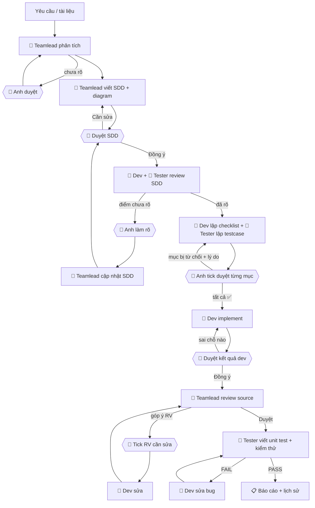

# ai-team — Teamlead + Dev + Tester cho Claude Code

> 📘 **Hướng dẫn cài đặt và sử dụng chi tiết: [HUONG-DAN.md](HUONG-DAN.md)**

Ba agent làm việc như một team nhỏ, **anh là người quyết định cuối cùng**:

| Vai | Làm gì | Được ghi |
|---|---|---|
| 🧭 **teamlead** | Đọc tài liệu, phân tích yêu cầu, chọn size, khảo sát base, viết **SDD + diagram Mermaid + gói ngữ cảnh**, cập nhật SDD theo góp ý, **review source** sau khi dev xong | Chỉ `docs/sdd/` |
| 🧠 **dev** | Review SDD với base thật → lập **checklist implement** → code đúng các mục đã duyệt → sửa lỗi | Code production |
| 🧪 **tester** (QC/QA) | Review SDD góc kiểm thử → lập **testcase** → viết unit test, kiểm thử độc lập → báo bug | File test + `docs/testcases/` |

## ⚡ v1.4 — chặt hơn, tốn ít token hơn
| Tính năng | Tác dụng |
|---|---|
| 🔐 **Hook theo giai đoạn** (`.ai-team/active.json`) | Dev chỉ sửa code ở `IMPLEMENT`/`FIX`; tester chỉ viết testcase ở `PLAN_REVIEW`, unit test ở `TEST` |
| 📄 **Allowlist từ checklist** | Dev chỉ sửa được **đúng các file** trong mục DEV-xx anh đã tick (+ ADD-xx anh duyệt thêm) → không đụng luồng cũ |
| 📏 **Baseline regression** | Chạy test toàn bộ trước khi code, so lại sau khi code → test cũ bị hỏng là báo đỏ ngay |
| 📦 **Gói ngữ cảnh** (SDD mục 5) | Chỉ teamlead khảo sát rộng; dev/tester chỉ đọc file trong gói → giảm mạnh token đọc code |
| 📐 **Size S/M/L** | Task nhỏ dùng Mini-SDD, bỏ vòng review SDD; task lớn đề xuất chia nhỏ |
| ⏯️ **`/resume`** | `/clear` giữa các giai đoạn mà không mất trạng thái; hết quota thì mở lại chạy tiếp |
| 📚 **`lessons.md`** | Lỗi lặp lại thành bài học, agent đọc trước khi làm → ít vòng sửa dần |
| ✂️ **Báo cáo gọn, test theo module, `maxTurns`** | Báo cáo ≤ 60 dòng, log luôn `tail`, agent không chạy vô hạn |

## 🚦 Cổng duyệt
- Bất kỳ agent nào gặp điều **chưa rõ** đều dừng lại và đưa bảng `🙋 CẦN ANH DUYỆT`. Claude hỏi anh từng mục **Đồng ý / Không đồng ý**.
- Không đồng ý → Claude hỏi **"Sai chỗ nào?"** → agent làm lại → anh duyệt lại.
- Danh sách (checklist dev, testcase, góp ý review) được ghi vào `checklist.md` để anh **tick `[x]`** từng mục, hoặc chọn "Đồng ý tất cả".
- Mọi quyết định ghi vào `approvals.md`. Không ai tự làm khi chưa được duyệt.

## Luồng `/ship`


## Cài đặt (1 lần)
Cần `python3` trên máy (cho hook bảo vệ).
```
/plugin marketplace add dinhdeveloper/ai-team
/plugin install ai-team@dinh-tools
```
Chọn **Install for you (user scope)**. Kiểm tra: gõ `/` thấy `/ai-team:ship`, `/ai-team:sdd`...; hoặc `claude plugin list`.

## Mỗi project mới
1. Copy `templates/CLAUDE.md` vào gốc project và điền đủ, nhất là: **Lệnh**, **Thành phần dùng chung**, **Feature mẫu**, **🔒 Luồng được bảo vệ**, **Quy ước test**.
2. Tạo `docs/sdd/` và `docs/testcases/` (nên commit cả hai).
3. Thêm vào `.gitignore`: `.ai-team/active.json` (trạng thái trên máy). Nên commit `.ai-team/lessons.md`; `.ai-team/history/` commit nếu muốn cả team xem.
4. Điền **lệnh theo module** và **lệnh Baseline** trong `CLAUDE.md` — đây là chỗ tiết kiệm token nhiều nhất khi chạy test.

## Lệnh
| Lệnh | Giai đoạn | Làm gì |
|------|-----------|--------|
| `/ship <yêu cầu> testcase: ...` | Tất cả | Toàn bộ luồng ở trên |
| `/sdd <yêu cầu/tài liệu>` | 1–2 | Teamlead phân tích → SDD → anh duyệt |
| `/plan docs/sdd/<slug>/SDD.md` | 3–5 | Dev + tester review SDD → làm rõ → checklist + testcase → anh tick |
| `/dev docs/sdd/<slug>/SDD.md` | 6–8 | Dev code mục đã tick → anh duyệt → teamlead review source |
| `/test docs/sdd/<slug>/SDD.md` | 9–10 | Tester viết unit test + kiểm thử testcase đã tick → sửa lỗi |
| `/review [file/thư mục]` | — | Dev review source bất kỳ, anh chọn mục cần sửa |
| `/resume [task]` | bất kỳ | Tiếp tục task đang dở đúng giai đoạn |
| `/history [task \| bugs \| approvals \| lessons]` | — | Xem lịch sử, lỗi còn mở, quyết định của anh, bài học |

**Cách chạy tiết kiệm nhất:** `/ai-team:sdd` → `/clear` → `/ai-team:plan` → `/clear` → `/ai-team:dev` → `/clear` → `/ai-team:test`. Mỗi lần `/clear` xóa ngữ cảnh cũ, lệnh sau tự đọc trạng thái từ `.ai-team/`.

## Giai đoạn (phase) & hook
```
ANALYZE → SDD → PLAN_REVIEW → PLAN_APPROVED → IMPLEMENT → DEV_REVIEW ⇄ FIX → TEST ⇄ FIX → DONE
```
| Phase | Teamlead | Dev | Tester |
|---|---|---|---|
| ANALYZE, SDD | ghi SDD | ❌ | ❌ |
| PLAN_REVIEW | ghi SDD | ❌ | ghi testcase |
| PLAN_APPROVED, DEV_REVIEW | ghi SDD | ❌ | ❌ |
| IMPLEMENT, FIX | ghi SDD | chỉ file DEV/ADD đã tick | ❌ |
| TEST | ghi SDD | ❌ | ghi unit test |
Muốn chặn dev sửa code cả khi không có task: tạo `.ai-team/config.json` với `{"strict": true}`.
Lệnh của plugin có dạng đầy đủ `/ai-team:<lệnh>` (vd `/ai-team:ship`); bảng trên viết tắt cho gọn.

## Hook bảo vệ (`hooks/guard.py`)
| Ai | Bị chặn |
|---|---|
| teamlead | Ghi bất kỳ file nào ngoài `docs/sdd/`; Bash ghi/xóa file |
| dev | Ghi file test, `docs/testcases/`, `docs/sdd/`; ghi file ngoài checklist đã tick; ghi code sai giai đoạn; Bash ghi/xóa file; `pub add/remove` |
| tester | Ghi file ngoài thư mục test và `docs/testcases/`; ghi sai giai đoạn; Bash ghi/xóa file, đổi git, đổi dependency |
| cả ba | Ghi vào `.ai-team/`; `git commit / push / reset --hard / clean / merge / rebase` |
| anh (phiên chính) | Không bị chặn |

## Lịch sử
```
.ai-team/
├── active.json                   # task đang chạy + phase (hook đọc)
├── lessons.md                    # bài học dùng chung
└── history/
    ├── INDEX.md                  # task, size, phase, số vòng sửa, BUG, RV
    └── 20261021-1500-vietqr/
        ├── request.md            # yêu cầu gốc
        ├── approvals.md          # mọi quyết định Đồng ý / Không + lý do của anh
        ├── checklist.md          # ☑️ tick duyệt: DEV-xx, TCxx, RV-xx, ADD-xx
        ├── timeline.md           # 🧭 teamlead · 🧠 dev · 🧪 tester · 👤 anh
        ├── baseline.md  after-01.md   # test trước/sau khi code (regression)
        ├── lead-01-analyze.md  lead-02-sdd.md  lead-03-review.md
        ├── dev-01-review.md  dev-02-checklist.md  dev-03-implement.md  dev-04-fix.md
        ├── test-01-review.md  test-02-testcase.md  test-03-run.md
        ├── bugs.md               # BUG (tester) + RV (teamlead): Open → Fixed → Verified
        └── summary.md
docs/sdd/vietqr/SDD.md        # SDD có version + lịch sử thay đổi
docs/testcases/vietqr.md      # testcase đã duyệt
```
Tester không đọc `dev-*.md` để giữ tính độc lập.

## Lưu ý quota (gói Pro)
- Chạy từng lệnh + `/clear` giữa các giai đoạn thay vì `/ship` một mạch.
- Để teamlead chọn size S cho task nhỏ (bỏ được 1 vòng review SDD của 2 agent).
- Giữ `CLAUDE.md` ≤ 150 dòng — nó được nạp vào mọi agent ở mọi lượt.
- Xem quota bằng `/usage`.

## Cập nhật plugin
Sửa → tăng `version` trong `.claude-plugin/plugin.json` → push → trên máy:
```bash
claude plugin update ai-team@dinh-tools
```
(hoặc `/plugin` → **Marketplaces** → `dinh-tools` → **Update marketplace**), rồi mở phiên `claude` mới. Bật **Enable auto-update** ở cùng màn hình để tự cập nhật.
