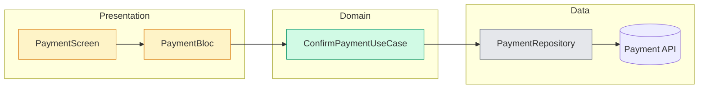
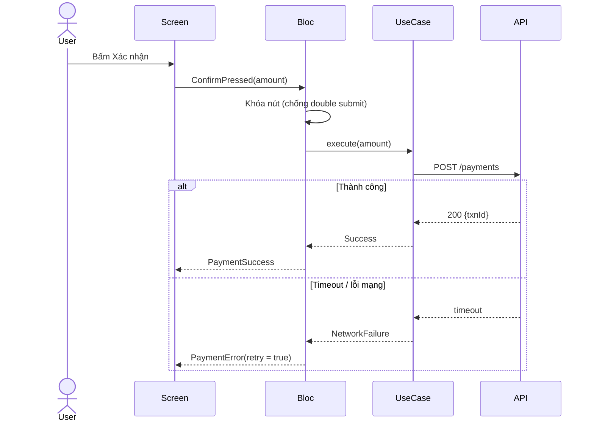
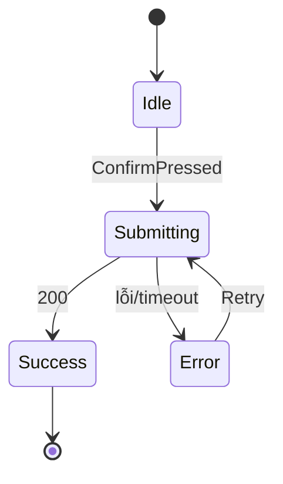
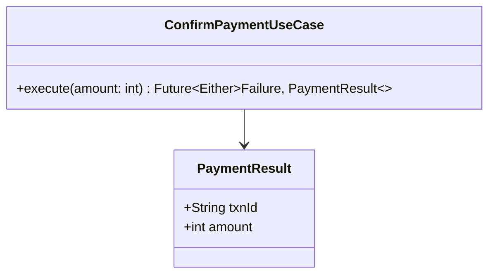

# SDD: <Tên tính năng>

| Version | Size | Trạng thái | Ngày | Tác giả | Người duyệt |
|---|---|---|---|---|---|
| v1.0 | S / M / L | Draft / Approved | yyyy-MM-dd | 🧭 teamlead | 👤 Dinh |

> **Size S → Mini-SDD:** chỉ cần mục 1, 2, 4, 5, 9, 10 (+ 7 nếu có thay đổi 🟡). Không bắt buộc diagram.

## 1. Bối cảnh & mục tiêu
<Vì sao làm, giải quyết vấn đề gì, đo thành công thế nào>

## 2. Phạm vi
| Trong phạm vi | Ngoài phạm vi |
|---|---|
| ... | ... |

## 3. Tài liệu tham chiếu
- Nghiệp vụ: `docs/...`
- API: `docs/api/...`
- Design: <link>
- Testcase: `docs/testcases/...`

## 4. Yêu cầu nghiệp vụ & Acceptance criteria
| AC | Điều kiện | Hành động | Kết quả mong đợi |
|---|---|---|---|
| AC01 | Số dư đủ | Nhập 100.000đ, xác nhận | Hiển thị màn thành công, số dư giảm 100.000đ |
| AC02 | | Nhập 0đ | Nút Xác nhận bị disable |

## 5. Gói ngữ cảnh (dev/tester chỉ đọc các file này)
| File | Dòng | Vai trò | Đọc để |
|---|---|---|---|
| `lib/features/payment/data/payment_repository.dart` | 12–80 | Dùng lại | Gọi API thanh toán |
| `lib/features/transfer/presentation/transfer_bloc.dart` | — | File mẫu | Làm theo pattern bloc |
| `lib/core/utils/money_formatter.dart` | 5–30 | Dùng lại | Format VND |
| `test/features/transfer/transfer_bloc_test.dart` | — | Test mẫu | Phong cách test, mock |

## 6. Thiết kế

### 6.1 Kiến trúc

🟩 Mới · 🟨 Sửa · ⬜ Dùng lại

### 6.2 Luồng xử lý

### 6.3 Trạng thái

### 6.4 Model / Class

### 6.5 API contract
| Endpoint | Request | Response | Mã lỗi → xử lý |
|---|---|---|---|
| `POST /payments` | `{amount}` | `{txnId}` | `E001` → báo số dư không đủ |

### 6.6 UI / màn hình
<Theo design; ghi rõ trạng thái loading, error, empty>

### 6.7 Xử lý lỗi, timeout, retry, double submit
- ...

## 7. Ảnh hưởng luồng cũ
| Chỗ thay đổi | Loại | Nơi đang dùng | Rủi ro | Đã duyệt |
|---|---|---|---|---|
| `PaymentBloc` thêm event | 🟡 | `payment_screen.dart` | Thấp | — |
| Đổi chữ ký `pay()` | 🔴 | 3 nơi: ... | Cao | D2 (yyyy-MM-dd) |

## 8. Bảo mật & logging
- Không log `amount`, `accountNo`, token
- ...

## 9. Kế hoạch implement
| Bước | Việc | File (đường dẫn đầy đủ) | Loại |
|---|---|---|---|
| 1 | Tạo `ConfirmPaymentUseCase` | `lib/features/payment/domain/confirm_payment_usecase.dart` [MỚI] | 🟢 |
| 2 | Đăng ký DI | `lib/core/di/injector.dart` | 🟡 |
| 3 | ... | ... | ... |

## 10. Kế hoạch test
**Lệnh test theo module:** `flutter test test/features/payment 2>&1 | tail -80`

| AC | Testcase | Unit test dự kiến | Ghi chú |
|---|---|---|---|
| AC01 | TC01 | `test/features/payment/confirm_payment_usecase_test.dart` | |

## 11. Rủi ro
| Rủi ro | Khả năng | Ảnh hưởng | Giảm thiểu |
|---|---|---|---|

## 12. Quyết định đã duyệt
| # | Quyết định | Người duyệt | Ngày |
|---|---|---|---|
| D1 | ... | 👤 Dinh | yyyy-MM-dd |

## 13. Lịch sử thay đổi
| Version | Ngày | Thay đổi | Lý do |
|---|---|---|---|
| v1.0 | yyyy-MM-dd | Tạo mới | |
